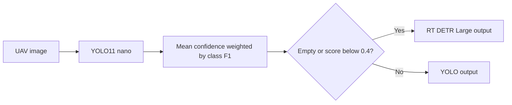

# Adaptive Inference for UAV Object Detection

A small–large detector cascade for crowded aerial scenes, with an inspectable routing policy and reproducible analysis of archived training logs.

**Reported system result:** 0.5621 test mAP@0.5 versus 0.5660 for RT-DETR-Large, with 18.1% less total inference time. These values come from the course final report; the final evaluation has not been rerun here.

## What to inspect

| Capability | Evidence |
| --- | --- |
| Deep learning training analysis | [Archived CSVs and computed peaks](evidence/audit.json): RT-DETR AP50 peaks at epoch 31, AP50:95 at epoch 35 |
| Conditional inference | [Router](router.py): class F1 weighting, image-level threshold, empty-detection fallback |
| Input contracts | Reject unmapped labels and nonfinite or out-of-range confidence values |
| Verification | [Seven tests](tests/test_router.py) cover report examples, boundary behavior and failure paths |
| Experiment integrity | Reported test results, archived validation results and later reconstruction are explicitly identified |



## Run without a GPU or model credentials

Python 3.10+; standard library only.

```bash
python -m unittest discover -s tests -v
python audit.py
python -c "from router import route; print(route([('car', 0.6)]))"
```

`audit.py` regenerates the checked-in summary from the two archived CSVs and the explicitly labeled report figures. It neither trains nor runs a detector. The router is a post-project reconstruction of the final report's rule, not recovered historical source. It accepts already-produced detections; an image inference adapter is not included.

## Training evidence

| Archived run | Classes shown in matrix | Epochs | Best validation AP50 | Best validation AP50:95 |
| --- | ---: | ---: | ---: | ---: |
| RT-DETR-Large | 5 | 60 | 0.68045 at 31 | 0.42085 at 35 |
| YOLO11-nano | 10 | 120 | 0.44640 at 68 | 0.26551 at 70 |

RT-DETR's retained configuration uses pretrained weights, 1280 input size, batch 6, AdamW, initial learning rate 5e-4, weight decay 1e-4, five warmup epochs and cosine decay. These are recorded settings, not controlled estimates of each parameter's benefit. Continuing training lowered training losses while validation quality weakened slightly, supporting validation-based checkpoint selection.

The runs have different label spaces. Their validation scores are not a fair head-to-head comparison. The original five-class conversion and final checkpoint lineage must be recovered before reproducing the final comparison.

## Reported final system evaluation

| System | Test AP50 | Total time (s) | Large-model calls |
| --- | ---: | ---: | ---: |
| Small only | 0.1395 | 233.70 | 0% |
| Large only | 0.5660 | 2867.25 | 100% |
| Cascade | 0.5621 | 2346.85 | 78.7% |

The cascade retained 99.3% of large-model mAP and avoided large-model calls on 21.3% of images. Call savings differ from time savings because every image still incurs the small-model pass. A constant per-image cost approximation gives 2490.23 seconds, which differs from the reported total; original timing logs are needed to resolve that discrepancy. These measurements do not establish real-time onboard deployment.

## Design limitations and next evidence

F1-weighted confidence is a heuristic, not a calibrated probability. A mean over detected boxes cannot see missed objects and can mask a difficult object among many easy ones. The tests deliberately preserve that behavior rather than silently changing the reported method.

The next useful evaluation is a comparison of raw confidence, F1 weighting and random routing at matched large-model call rates, using a frozen validation/test protocol. It requires the original data mapping and prediction outputs. No new accuracy gain is claimed for this reconstruction.

## Provenance

Course project: CSCI 566, collaborative UAV detection system. Team: Yifei Zhao, Puwei He, Kuo Yu, Xinrui Shen, Ruifeng Li, Yunhao Xia. Puwei He confirms participation across model training, analysis and routing; the final report specifically records RT-DETR training and report/presentation work. This portfolio adds deterministic routing tests and log auditing after the course project.

Raw dataset images, original shared reports and model binaries are not bundled. Download data from the [VisDrone project](https://github.com/VisDrone/VisDrone-Dataset). YOLO11 and RT-DETR are existing model architectures, not newly proposed architectures.
